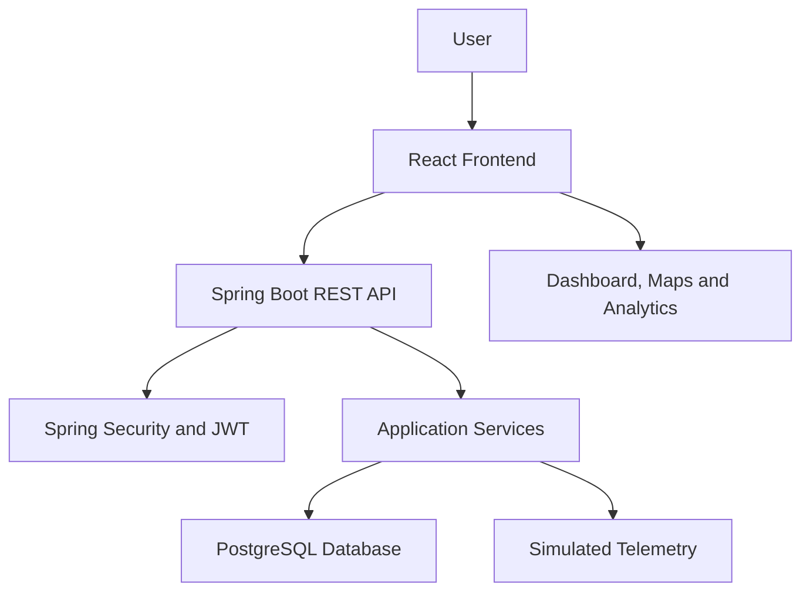

# AEGIS – AI-Based Counter-Drone Detection and Threat Management System

AEGIS is a web-based command and control application developed to demonstrate drone detection management, threat classification, surveillance monitoring, and incident response workflows. The project combines a React frontend with a Spring Boot backend and database integration.

**Live Demo:** https://aegis-counter-drone-c2-system.vercel.app

**Backend Health:** https://aegis-backend-z8wf.onrender.com/api/health

## 1. Project Overview

The system provides a centralized interface for monitoring simulated drone activity across defined surveillance sectors. It supports drone tracking, threat assessment, geofence monitoring, alert management, incident handling, and response team coordination.

The application follows a frontend-backend architecture:

- **Frontend:** Provides the dashboard, surveillance map, charts, and management interfaces.
- **Backend:** Handles REST API requests, authentication, drone records, and application services.
- **Database:** Stores application data and simulated telemetry.
- **Authentication:** Uses Spring Security, JWT, and BCrypt password hashing.
- **Simulation:** Generates synthetic drone and sensor activity for academic demonstration.

The application is designed as a software demonstration. It does not currently connect to physical radar, RF detection equipment, or operational counter-drone hardware.

## 2. Key Features

| Module | Description |
|---|---|
| Dashboard | Displays drone statistics, alerts, and monitoring summaries. |
| Drone Detection | Manages detected drone records and their status. |
| Threat Classification | Evaluates threat levels using configurable risk factors. |
| Surveillance Map | Displays drone positions and geofenced areas. |
| Sensor Management | Provides simulated sensor status and diagnostics. |
| Drone Tracking | Displays drone telemetry and movement information. |
| Incident Management | Creates and manages security incidents. |
| Response Teams | Manages response team information and deployment status. |
| Alert Management | Displays and manages security alerts. |
| Reports and Analytics | Presents monitoring statistics and historical summaries. |
| User Management | Supports user roles and access control. |
| System Settings | Provides application and simulation controls. |

## 3. Technology Stack

| Layer | Technology |
|---|---|
| Frontend | React 18 |
| Build Tool | Vite |
| Styling | Tailwind CSS |
| Backend | Java 21, Spring Boot 3.5.6 |
| Security | Spring Security, JWT, BCrypt |
| Database | PostgreSQL (production), H2 (local development) |
| Data Access | Spring Data JPA / Hibernate |
| Charts | Recharts |
| Maps | Leaflet, React-Leaflet |
| Icons | Lucide React |
| Deployment | Vercel and Render |

## 4. System Architecture



The frontend communicates with the backend through REST APIs. The backend manages authentication, application logic, and database operations. Simulated telemetry provides data for monitoring and demonstration.

## 5. Application Modules

### Dashboard
Provides an overview of drone activity, threat statistics, alerts, and monitoring information.

### Drone Detection and Tracking
Displays drone records, telemetry information, threat levels, and tracking status.

### Threat Classification
Uses proximity, altitude, velocity, payload information, and RF characteristics to calculate a threat score.

### Surveillance and Geofencing
Displays surveillance sectors, drone locations, and restricted monitoring zones on an interactive map.

### Sensor Management
Displays simulated sensor information and operational status.

### Incident and Response Management
Supports incident creation, status updates, team assignment, and response workflow management.

### Alerts and Reports
Provides alert monitoring, historical summaries, charts, and reporting features.

### User Management and Settings
Provides role-based access management and simulation configuration.

## 6. Installation and Local Setup

### Prerequisites

- Windows 10/11, Linux, or macOS
- Java 21 or later
- Node.js 18 or later
- npm
- Git

### Clone the Repository

```bash
git clone https://github.com/Ravi-M-2005/AEGIS-Counter-Drone-C2-System.git
cd AEGIS-Counter-Drone-C2-System
```

### Start the Backend

Open a terminal:

```powershell
cd aegis\aegis
mvn spring-boot:run
```

If Maven is not installed, use the Maven executable included in the project, if present.

### Start the Frontend

Open another terminal from the repository root:

```powershell
cd frontend
npm install
npm run dev
```

Open the local frontend address displayed by Vite, usually:

```text
http://localhost:5173
```

**Note:** The repository also includes Windows startup scripts. Refer to the actual script configuration for the supported local launch method.

## 7. Environment Configuration

Production deployment uses environment variables for sensitive configuration.

| Variable | Purpose |
|---|---|
| `SPRING_PROFILES_ACTIVE` | Selects the Spring Boot profile. |
| `DATABASE_URL` | Production database connection. |
| `AEGIS_JWT_SECRET` | JWT signing secret. |
| `AEGIS_ADMIN_USERNAME` | Initial administrator username. |
| `AEGIS_ADMIN_PASSWORD` | Initial administrator password. |
| `AEGIS_CORS_ALLOWED_ORIGINS` | Allowed frontend origins. |
| `VITE_API_BASE_URL` | Backend API base URL for the frontend. |

Use private environment settings for actual credentials. Do not commit `.env` files or secrets to GitHub.

## 8. API Overview

The backend provides REST APIs under the `/api` namespace.

| Method | Endpoint | Description |
|---|---|---|
| GET | `/api/health` | Checks backend availability. |
| POST | `/api/auth/login` | Authenticates users. |
| GET | `/api/drones` | Retrieves drone records. |
| GET | `/api/drones/stats` | Retrieves drone statistics. |
| GET | `/api/drones/{id}` | Retrieves a drone record. |
| POST | `/api/drones` | Creates a drone record. |
| PATCH | `/api/drones/{id}/status` | Updates drone status. |
| DELETE | `/api/drones/{id}` | Deletes a drone record. |

Protected endpoints require JWT authentication.

## 9. Deployment

### Frontend – Vercel

The React frontend is deployed using Vercel.

- Framework: Vite
- Build command: `npm run build`
- Output directory: `dist`
- Environment variable: `VITE_API_BASE_URL`

### Backend – Render

The Spring Boot backend is deployed on Render using Docker.

The production backend connects to PostgreSQL and uses environment-based configuration for authentication and security.

**Deployment URLs:**

- Frontend: https://aegis-counter-drone-c2-system.vercel.app
- Backend: https://aegis-backend-z8wf.onrender.com
- Health endpoint: https://aegis-backend-z8wf.onrender.com/api/health

The backend uses a free hosting instance, so its first request after inactivity may take longer to respond.

## 10. Project Limitations

- Drone positions and telemetry are generated synthetically.
- Physical radar, RF scanners, and EO/IR hardware are not integrated.
- Sensor status and response workflows are demonstrated through software simulation.
- Threat classification is intended for academic demonstration and is not a certified operational defense system.
- Actual hardware integration and field validation remain future work.

## 11. Future Enhancements

- Integration with real drone detection sensors.
- Live telemetry ingestion from external devices.
- Improved machine learning-based threat classification.
- Advanced historical analysis and reporting.
- Additional authentication and audit capabilities.
- Integration with external monitoring systems.

## 12. Academic Disclaimer

AEGIS is developed for educational purposes and software engineering demonstration. All drone telemetry, sensor activity, and response workflows are simulated unless explicitly connected to verified external data sources.

The application does not operate physical countermeasures, electronic warfare equipment, or weapon systems.

## 13. License

Refer to the repository's `LICENSE` file for licensing terms.

## 14. Repository

**GitHub:** https://github.com/Ravi-M-2005/AEGIS-Counter-Drone-C2-System
