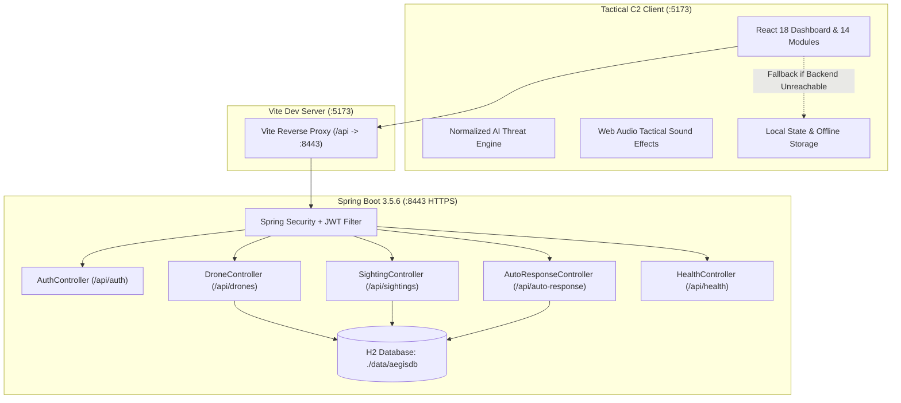

# AEGIS – AI-Based Counter-Drone Detection and Threat Management System


> **College Java Enterprise & Full-Stack Security Engineering Demonstration Project**  
> *Branding: AEGIS – AI-Powered Counter-Drone Surveillance & Threat Management*  
> *Status: Fully Integrated, Live Backend Connected (:8443) with Autonomous Simulation Fallback*

---

## 1. Project Overview & Architecture

**AEGIS** is a modern Command and Control (C2) web application engineered to detect, classify, track, and manage unauthorized unmanned aerial systems (UAVs / drones) operating in sensitive airspace, including commercial international airports, defense military bases, border outposts, and critical infrastructure facilities.

The platform provides a dual-layer architecture:
1. **Frontend Tactical Command Center (React 18 + Vite + Tailwind CSS)**: Features an ultra-responsive dark tactical interface (`#050b14`), high-contrast neon cyan/electric blue telemetry, audio alarm synthesizer, interactive Leaflet defense radar maps with dynamic geofence zones, real-time Recharts visualizations, and 14 enterprise modules.
2. **Enterprise Backend Services (Java Spring Boot 3.5.6)**: Delivers secure HTTPS REST APIs on port `8443` using a local PKCS12 keystore (`aegis-local.p12`), BCrypt password hashing, stateless JWT Bearer token authentication, input validation, H2 file-backed persistence (`./data/aegisdb`), and simulated auto-response management.
3. **Vite Reverse Proxy**: Bridges `http://localhost:5173/api` to `https://localhost:8443` with TLS verification bypass for local self-signed certificates, eliminating browser CORS restrictions and certificate warnings.



---

## 2. Technology Stack

| Layer | Component | Version / Description |
|---|---|---|
| **Frontend Framework** | React.js | `18.3.1` (SPA architecture with Hooks & Context API) |
| **Build & Dev Tool** | Vite | `5.4.21` with Hot Module Replacement & Proxy |
| **Tactical Styling** | Tailwind CSS | `3.4.17` (Military dark theme, cyan/emerald/red neon) |
| **Icons & Visuals** | Lucide React | `0.475.0` (Tactical military icons) |
| **Charts & Metrics** | Recharts | `2.15.1` (Radar, area, line, bar, pie distribution) |
| **Surveillance Maps** | Leaflet & React-Leaflet | `1.9.4` & `4.2.1` with OpenStreetMap CartoDB Dark Matter |
| **Audio Alerting** | Web Audio API | Synthesized military sirens, sonar pings, clicks, alarms |
| **Backend Runtime** | Java OpenJDK | Java 21 / 26 compatible |
| **Enterprise Framework** | Spring Boot | `3.5.6` (`spring-boot-starter-web`, `security`, `validation`, `data-jpa`) |
| **Authentication** | JWT (jjwt 0.12.6) | HS512 Bearer Token + BCrypt Password Encoder |
| **Embedded Database** | H2 Database Engine | File-backed (`jdbc:h2:file:./data/aegisdb`) |
| **Security Keystore** | PKCS12 Keystore | `aegis-local.p12` (Self-signed 2048-bit RSA for local HTTPS) |

---

## 3. Quick Start & Execution Guide

### Prerequisites
- Windows 10/11 (or Linux/macOS)
- Java OpenJDK 21 or higher
- Node.js 18+ and npm (Portable Node 20.18.0 is included in `.bin/` for instant standalone execution on Windows)

### One-Click Launch (Windows Batch / PowerShell)

#### Option A: Windows Batch Files (Double-Click)
1. **Start Backend**: Double-click `start-backend.bat` in the project root.
   - Automatically builds the backend JAR if missing.
   - Runs Spring Boot on `https://localhost:8443` with the `aegis-local.p12` keystore.
2. **Start Frontend**: Double-click `start-frontend.bat` in the project root.
   - Sets the Node PATH and launches Vite dev server on `http://localhost:5173`.
3. Open `http://localhost:5173` in your browser.

#### Option B: PowerShell Scripts
```powershell
# In Terminal 1 (Backend):
.\start-backend.ps1

# In Terminal 2 (Frontend):
.\start-frontend.ps1
```

#### Option C: Manual CLI Commands
```powershell
# 1. Compile & Run Backend:
cd aegis\aegis
..\..\.bin\maven\bin\mvn.cmd package -DskipTests
java -jar target\aegis-backend-0.0.1-SNAPSHOT.jar

# 2. Run Frontend:
cd frontend
npm install
npm run dev
```

### Access URLs
- **Web Tactical Dashboard**: [http://localhost:5173](http://localhost:5173)
- **Backend Health Check**: [https://localhost:8443/api/health](https://localhost:8443/api/health)
- **H2 Database Console**: [https://localhost:8443/h2-console](https://localhost:8443/h2-console)
  - JDBC URL: `jdbc:h2:file:./data/aegisdb`
  - Username: `sa`
  - Password: *(leave blank)*

---

## 4. Demo Credentials & Access Levels

The system features role-based access control (RBAC) with seeded credentials in both the Spring Boot database and simulation fallback:

| Username | Password | Role | Security Clearance | Permissions |
|---|---|---|---|---|
| **`admin`** | **`Admin@123`** | **Administrator** | LEVEL 5 - TOP SECRET | Full command access, incident creation, team dispatch, zone modifications, system settings, user management |
| **`operator1`** | **`ChangeMe123!`** *(or `Admin@123`)* | **Command Center Operator** | LEVEL 2 - CONFIDENTIAL | Live map surveillance, drone tracking, alert acknowledgment, sensor telemetry monitoring |
| **`officer_sharma`** | **`Admin@123`** | **Security Officer** | LEVEL 3 - SECRET | Threat evaluation, incident report generation, QRT team assignment, radar filter controls |

> [!NOTE]
> Authentication validates credentials strictly via the Spring Boot backend (`POST /api/auth/login`). If the backend is running, invalid passwords return HTTP 401/403 and are firmly rejected. If the backend is stopped, the application seamlessly switches to **Standalone Simulation Mode** allowing demonstration without service interruption.

---

## 5. Overview of the 14 Application Modules

The AEGIS Command & Control suite incorporates 14 defense modules accessible via the tactical left sidebar:

1. **Authentication & C2 Terminal Login (`/login`)**:
   - Military-style authorization portal with quick-fill role presets (`Administrator`, `Operator`, `Security Officer`).
   - Dynamic terminal badge indicating `SPRING BOOT ACTIVE (:8443)` or `SIMULATION MODE`.
   - Security disclaimer: *Simulation Mode – Demo Data*.

2. **Main Command Dashboard (`/dashboard`)**:
   - 8 tactical KPI StatCards: Total Drones Detected, Active Tracking, High-Risk Targets, Critical Alerts, Active Geofence Zones, Operational Sensors, Open Incidents, Deployed Teams.
   - Interactive Recharts: 24-Hour Incursion Hourly Trends, Threat Severity Distribution (Low/Med/High/Critical), and Drone Type Breakdown.
   - Live Alert Stream with audio alarms and Quick Incident Escalation buttons.
   - Recent Detections table with real-time drone telemetry and jump-to-tracking links.

3. **Live Drone Surveillance Map (`/surveillance`)**:
   - Fullscreen Leaflet defense radar map with CartoDB Dark Matter tiles.
   - Multi-sector switching: **Bengaluru International Airport (KIA)**, **Northern Border Outpost**, and **Naval Coastal Defense**.
   - Interactive circular geofences: Red Zone (Inner 1.5 km - No Fly), Yellow Zone (Buffer 3.5 km), Green Zone (Outer 7.0 km).
   - Moving drone targets with velocity vectors, altitude tags, and interactive popups with direct *"Track Target"* and *"Escalate Incident"* triggers.
   - Tactical radar sweep animation overlay and full map layer toggles (Drones, Zones, Sensors, Radar Sweep).

4. **Drone Detection Management (`/detections`)**:
   - Comprehensive inventory of all detected aerial targets across the monitored sector.
   - Search by Drone ID, filter by Threat Level (Critical, High, Medium, Low), or filter by Status (Tracking, Intercepted, Cleared).
   - Telemetry details: Aircraft Model, Speed (km/h), Altitude (m AGL), Range (km), RF Frequency Band, Confidence Index, and Payload Status.
   - Direct action triggers: Update status to *"Intercepted"* or *"Cleared"*, or dispatch QRT.

5. **AI Threat Assessment & Classification Matrix (`/threats`)**:
   - Real-time threat classification engine inspecting 5 weighted risk vectors.
   - Normalized 0–100 threat score meter with color-coded severity badges.
   - Interactive **Threat Simulation Calculator**: Adjust proximity, altitude, velocity, payload detection, and RF encryption in real-time to observe dynamic risk score recalculation.
   - Defense response protocol guidance matrix (Passive Surveillance, Active Radar Tracking, ATC Warning, QRT Deployment).

6. **Surveillance Zones & Geofencing (`/zones`)**:
   - Management interface for restricted airspace boundaries and exclusionary perimeters.
   - Zone configuration: Red Core Restricted Zone, Runway Glidepath Buffer, Terminal Approach Zone.
   - Real-time statistics: Target count inside each perimeter, breach alerts, and radius modification controls.
   - Ability to add, edit, or adjust geofence radius and restriction tier.

7. **Sensor Station Network (`/sensors`)**:
   - Diagnostics for multi-modal sensor arrays: **3D AESA Radar**, **RF Spectrum Analyzers**, **Long-Range EO/IR Cameras**, and **Acoustic Sensor Arrays**.
   - Live telemetry status: Operational, Degraded, Calibrating, Offline.
   - Sensor specifications: Detection range (km), active frequency band, sensitivity index, signal-to-noise ratio, and last calibration timestamp.
   - Interactive sensor reboot and calibration simulation triggers.

8. **Drone Tracking & 3D Trajectory Telemetry (`/tracking`)**:
   - High-precision telemetry view for individual drone targets.
   - Target selector to switch between active radar contacts.
   - Real-time flight vector charts: Altitude profile over time, Speed variation graph, Distance to perimeter descent trajectory.
   - Estimated Time to Perimeter Breach (ETB) countdown calculator.
   - Waypoint trail tracking with compass heading and GPS coordinate log.

9. **Incident Management & Workflows (`/incidents`)**:
   - Standard Operating Procedure (SOP) workflow management for airspace incursions.
   - Incident tracking with unique IDs (`INC-2026-001`), severity classification, assigned Quick Reaction Team, and resolution status.
   - Incident lifecycle actions: Assign Response Team, Escalate Priority, Add Tactical Notes, Mark Resolved.
   - Print-friendly Incident Incident Export view.

10. **Quick Reaction Teams (QRT) & Response Deployment (`/teams`)**:
    - Ground security and air defense team management.
    - Teams: *Alpha QRT (Mobile Interceptor)*, *Bravo Unit (Tactical Net Gunner)*, *Delta Squad (Perimeter Patrol)*, *Sierra Command (ATC Liaison)*.
    - Status indicators: On Standby, Deployed, In Transit, Refueling.
    - Unit equipment, active deployment zone, assigned personnel roster, and simulated deployment dispatcher.

11. **Alert Management & DEFCON Alarms (`/alerts`)**:
    - Centralized alert triage queue.
    - Visual DEFCON priority indicators: Critical Red Incursions, High Yellow Boundary Breaches, Medium RF Anomalies.
    - Bulk acknowledgment and individual alert dismiss controls.
    - Web Audio acoustic alert integration (siren horn for critical threats, tactical pings for medium alerts).

12. **Analytics, Audit Logs & Historical Reports (`/reports`)**:
    - Historical trend intelligence over 7-day and 30-day monitoring cycles.
    - Peak incursion time distribution chart (identifying twilight and night-time vulnerabilities).
    - Drone model frequency analysis (DJI Matrice, Custom FPV, Fixed-Wing reconnaissance).
    - Immutable security audit log showing user actions, status transitions, and automated events.
    - Instant **Export to CSV** and **Print Defense Report** buttons.

13. **Operator & User Access Control (`/users`)**:
    - Operator clearance roster with active session monitoring.
    - User creation modal: Name, username, clearance level, role, department, and contact phone.
    - Role toggles: Administrator, Command Center Operator, Security Officer, ATC Liaison.
    - Revoke and enable user account switches.

14. **System Configuration & Simulator Controls (`/settings`)**:
    - Master simulation controls: Play/Pause simulation loop, simulation speed multiplier (0.5x, 1x, 2x, 5x).
    - Incursion generator buttons: *"Inject Simulated Drone"*, *"Trigger Critical Incursion"*.
    - Reset Demo State button (restores original baseline demo data instantly).
    - Audio alarm volume and mute toggles.
    - REST Backend connectivity inspector: Target port 8443, latency diagnostics, and connection retry button.

---

## 6. AI Threat Evaluation Algorithm & Math

The AEGIS threat evaluation model uses a multi-factor weighted rule matrix. The raw score has a theoretical maximum of **105 points** and is normalized to an intuitive **0–100 scale**:

$$\text{NormalizedScore} = \min\left(100, \max\left(5, \text{round}\left(\frac{\text{RawScore}}{105} \times 100\right)\right)\right)$$

### Evaluation Vector Weights

| Factor | Condition | Raw Points | Max Pts |
|---|---|---|---|
| **1. Proximity to Asset** | Distance $\le 1.0\text{ km}$<br>Distance $\le 2.5\text{ km}$<br>Distance $\le 5.0\text{ km}$<br>Distance $> 5.0\text{ km}$ | 35 pts<br>26 pts<br>15 pts<br>5 pts | **35 pts** |
| **2. Altitude Profile** | $< 60\text{m AGL}$ (Terrain-masking evasion)<br>$> 250\text{m AGL}$ (Commercial flight path hazard)<br>$150 - 250\text{m AGL}$<br>$60 - 150\text{m AGL}$ | 20 pts<br>18 pts<br>10 pts<br>5 pts | **20 pts** |
| **3. Velocity / Speed** | $> 100\text{ km/h}$ (High-speed sprint / dive)<br>$65 - 100\text{ km/h}$ (Rapid transit)<br>$< 10\text{ km/h}$ (Stationary loiter / surveillance hover)<br>$10 - 65\text{ km/h}$ (Nominal transit) | 20 pts<br>14 pts<br>12 pts<br>6 pts | **20 pts** |
| **4. Payload Detection** | Auxiliary pod / gimbal / suspended package detected<br>No external payload | 20 pts<br>0 pts | **20 pts** |
| **5. RF Telemetry Band** | Encrypted / Frequency Hopping / Silent / Military band<br>Standard 2.4 GHz / 5.8 GHz ISM WiFi | 10 pts<br>3 pts | **10 pts** |

### Threat Classification Tiers

| Tier | Normalized Score | Tactical Response Protocol |
|---|---|---|
| **LOW** | **0 – 30** | Maintain passive surveillance. Record RF telemetry and camera feed in routine flight database. No physical intervention required. |
| **MEDIUM** | **31 – 60** | Cue long-range EO/IR cameras for optical tracking. Alert perimeter security guards to visual standby. Prepare acoustic triangulation. |
| **HIGH** | **61 – 80** | Notify Air Traffic Control (ATC) watch officer. Standby Quick Reaction Team (QRT) mobile vehicle. Activate RF direction-finding sensors. |
| **CRITICAL** | **81 – 100** | **DEFENSE CONDITION RED**: Trigger command room sirens. Issue immediate airfield/runway hold. Dispatch QRT interceptor unit to boundary post. Notify Base Commander. |

---

## 7. REST API Reference

The Spring Boot backend exposes REST endpoints under the `/api` namespace:

| Method | Endpoint | Authorization | Description |
|---|---|---|---|
| `GET` | `/api/health` | Public | Returns `{"service":"aegis-backend","status":"UP"}` for health probes |
| `POST` | `/api/auth/login` | Public | Authenticates credentials and returns JWT Bearer token + user role |
| `GET` | `/api/drones` | Bearer JWT | Returns active drones filtered by `locationId` (e.g. `bengaluru`) and `rangeKm` |
| `PATCH` | `/api/drones/{id}/status` | Bearer JWT | Updates drone state (`TRACKING`, `INTERCEPTED`, `CLEARED`, `LOST`) |
| `GET` | `/api/sightings` | Bearer JWT | Retrieves historical drone sighting events for the specified location |
| `POST` | `/api/sightings` | Bearer JWT | Records a new sighting event into the H2 database (`droneId`, `threatScore`) |
| `GET` | `/api/response-events` | Bearer JWT | Lists recent simulated defense response events |
| `POST` | `/api/auto-response` | Bearer JWT | Toggles simulated automated review and queues simulated review records |

---

## 8. 5–10 Minute College Project Demonstration Script

Follow this structured presentation flow for an impactful college or technical demo:

### Step 1: System Boot & Live Backend Verification (1 min)
1. Launch `start-backend.bat` and `start-frontend.bat`.
2. Open `http://localhost:5173` in Google Chrome or Microsoft Edge.
3. Show the **Login Screen**:
   - Point out the terminal status badge at the top: `SPRING BOOT ACTIVE (:8443)`.
   - Mention the TLS keystore configuration running on port 8443 and the seamless Vite proxy.
   - Click the **Quick Fill: Administrator** preset (`admin` / `Admin@123`).
   - Click **Authorize Access** to log in.

### Step 2: Main Command Dashboard & Defense Metrics (1.5 min)
1. Highlight the tactical dark styling (`#050b14`), cyan glow accents, and responsive layout.
2. Review the **8 KPI StatCards** (Total Drones, Active Targets, Critical Alerts, Geofences, Sensors, Incidents, QRT Teams).
3. Demonstrate the **Recharts visual analytics**:
   - Hover over the 24-Hour Incursion graph to show hourly volume spikes.
   - Point out the Threat Distribution chart showing risk balance.
4. Show the live **Alert Feed** updating every 3–4 seconds as the simulation runs.

### Step 3: Interactive Live Drone Surveillance Radar Map (2 min)
1. Click **Live Surveillance** on the sidebar.
2. Explain the **Leaflet map**:
   - The map centers on **Kempegowda International Airport (Bengaluru)** with OpenStreetMap dark tiles.
   - Explain the 3 color-coded concentric geofences: Red Zone (Inner 1.5 km), Yellow Buffer (3.5 km), Green Outer Perimeter (7.0 km).
   - Point out the rotating radar sweep animation simulating active AESA radar sweeps.
3. Click any moving drone marker:
   - Show the drone popup displaying Drone ID, Speed, Altitude, and Threat Score.
   - Click the **Sector Switcher** in the header to switch to **Northern Border** or **Naval Defense** and show dynamic map recentering.

### Step 4: Threat Simulation & Rule-Based AI Engine (1.5 min)
1. Click **Threat Classification** on the sidebar.
2. Explain the **Normalized AI Threat Engine**:
   - Explain the 5 vectors: Proximity (35 pts), Altitude (20 pts), Speed (20 pts), Payload (20 pts), RF Link (10 pts).
   - Show the formula normalizing the 105 raw points to a 0–100 scale.
3. Use the interactive **Threat Simulation Calculator**:
   - Drag distance from 5 km down to 0.5 km.
   - Toggle **Payload Detected** to ON.
   - Select **Frequency Hopping / Silent** RF band.
   - Watch the score jump to **92 (CRITICAL)** and note the automated response change to *"IMMEDIATE ESCALATION: Alert Air Traffic Control & Scramble QRT"*.

### Step 5: Incident Escalation & Response Team Dispatch (1.5 min)
1. Click the **Simulate Incursion** button in the top header.
2. An alert chime sounds and a new threat appears in the feed.
3. Navigate to **Incident Management**:
   - Show the active incident list.
   - Click **Assign Team** on an active incident and select **Alpha QRT (Mobile Interceptor)**.
   - Change incident status to **In Progress**, then **Resolved**.
4. Navigate to **Response Teams**:
   - Show *Alpha QRT* marked as *In Transit* with deployment coordinates and assigned officer.

### Step 6: Sensors, Reports, Users & Settings (1 min)
1. Briefly showcase:
   - **Sensor Stations**: Diagnostic statuses of Radar, RF scanners, and cameras.
   - **Reports & Analytics**: Peak incursion hours and the **Export CSV** feature.
   - **User Management**: Role-based access control with clearance levels.
   - **System Settings**: Simulation speed controls (1x, 2x, 5x) and demo data reset.
2. Click **Reset Demo Data** to demonstrate state re-initialization.
3. Conclude with the safety summary: **All drone movements, tracking coordinates, and response protocols are strictly simulated for academic and demonstration integrity.**

---

## 9. Safety, Regulatory & Academic Integrity Disclaimer

> [!IMPORTANT]
> **SAFETY NOTICE**: AEGIS is developed exclusively for educational research, academic defense technology presentation, and software engineering coursework. 
> - All drone telemetry, radar positions, RF frequencies, and aircraft tracks are **algorithmically generated simulations**.
> - The software contains **no kinetic weapon triggers, no electronic warfare jamming transmitters, and no unauthorized RF radiation controls**.
> - All countermeasures are designed as standard defense workflow simulations (inter-agency alerts, guard dispatch, and air traffic control advisory notifications).

---

## 10. Production & Cloud Deployment Guide (Vercel & Java Cloud Hosts)

### Frontend Deployment on Vercel
1. AEGIS includes a production-ready `frontend/vercel.json` with Single Page Application (SPA) HTML5 history rewrites.
2. In the Vercel Dashboard:
   - **Framework Preset**: Vite
   - **Root Directory**: `frontend` (or repository root if using the root `vercel.json`)
   - **Build Command**: `npm run build`
   - **Output Directory**: `dist`
3. **Environment Variables**:
   - Add `VITE_API_BASE_URL` pointing to your hosted Spring Boot backend REST endpoint:
     ```
     VITE_API_BASE_URL=https://your-aegis-backend.onrender.com/api
     ```

### Backend Cloud Hosting (Render / Railway / Fly.io / AWS)
> [!NOTE]
> Vercel is specialized for static frontends, Serverless functions, and Edge middleware, and cannot execute long-running Java Virtual Machine (JVM) Spring Boot applications. The Spring Boot backend must be deployed to a Java-compatible container or platform host:

1. **Option A: Render.com (Docker or Native Java)**
   - Create a Web Service with Java 21+ runtime or Docker.
   - Build Command: `./mvnw clean package -DskipTests` (or `mvn package -DskipTests`)
   - Start Command: `java -jar aegis/aegis/target/aegis-backend-0.0.1-SNAPSHOT.jar`
   - Set environment variables:
     - `SERVER_PORT=8080` (or leave 8443 with TLS disabled for cloud load balancers)
     - `SPRING_PROFILES_ACTIVE=prod`
     - `AEGIS_JWT_SECRET=<secure-random-32-byte-secret>`

2. **Option B: Railway.app / Fly.io**
   - Connect GitHub repository and select the `aegis/aegis` folder.
   - Railway automatically detects Maven and packages the Spring Boot JAR.

3. **CORS Configuration**:
   - `SecurityConfig.java` is pre-configured to allow CORS origins matching `http://localhost:*`, `https://*.vercel.app`, and custom production domains with full credentials and JWT Bearer authorization headers.

---

## 11. Automated 18-Point E2E Integration Suite

AEGIS includes an automated headless Chrome testing suite that validates the full stack end-to-end:
```powershell
node --experimental-websocket scratch/e2e-audit-test.mjs
```

### Verified Test Matrix (18 of 18 Tests Passing):
1. **TEST 1**: Fresh browser opens C2 Terminal Login Page with empty credentials and show/hide passcodes.
2. **TEST 2**: Valid administrator authentication (`admin` / `Admin@123`) establishes session and verifies role.
3. **TEST 3**: Valid operator authentication (`operator1` / `ChangeMe123!`) verifies `Command Center Operator` role.
4. **TEST 4**: Valid security officer authentication (`officer_sharma` / `Admin@123`) verifies `Security Officer` role.
5. **TEST 5**: Invalid passcode rejection displays explicit security warning badge without session creation.
6. **TEST 6**: Tactical Command Dashboard loads with header, sidebar navigation, and command controls.
7. **TEST 7**: All 8 tactical KPI metric cards display live data (Total Drones, Active, High-Risk, Alerts, Zones, Sensors, Incidents, Teams).
8. **TEST 8**: Drone telemetry loads live records from Spring Boot backend database.
9. **TEST 9**: Leaflet CartoDB dark surveillance map initializes with multi-tier circular geofences.
10. **TEST 10**: Recharts data visualizations render dynamic threat distribution and 24-hr velocity profiles.
11. **TEST 11**: Tactical sidebar navigation transitions smoothly across all 13 application views.
12. **TEST 12**: Role-based access control enforces admin-only mutations; non-admin users display read-only clearance.
13. **TEST 13**: Header user menu sign-out purges JWT from memory and localStorage, returning to C2 Terminal Login.
14. **TEST 14**: Browser reload preserves valid authenticated session and telemetry streams.
15. **TEST 15**: Expired or counterfeit JWT tokens are detected and rejected on initialization.
16. **TEST 16**: REST API failures return structured HTTP 401/403/404 messages with clear user feedback.
17. **TEST 17**: Frontend production build (`npm run build`) generates clean distribution bundle in `dist/`.
18. **TEST 18**: Backend packaging (`mvn package`) generates deployable Spring Boot executable JAR without compilation errors.

---

## 12. Authors & Acknowledgments

- **Project Lead**: AEGIS Engineering Team
- **Course**: Java Enterprise Systems & Full-Stack Security Engineering
- **Institution**: Department of Computer Science & Engineering
- **Demonstration Date**: 2026-10-28
- **License**: MIT Academic Demonstration License
